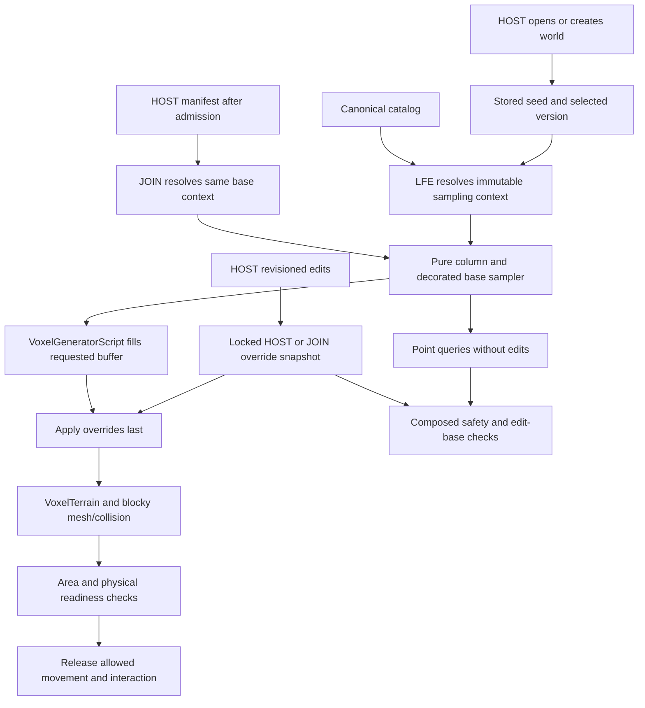

# W6.4-D0 — Macro World Generation design contract

**DRAFT FOR OWNER REVIEW — 2026-10-19 (Australia/Perth).**

This document prepares W6.4 design only. **W6.4 production implementation remains
NOT AUTHORISED.** Proposed interfaces, algorithms, numeric values, task boundaries
and acceptance budgets below require final owner review and separate implementation
authorisation. No gameplay/engine implementation, schema/content change, new
canonical ID, plugin upgrade, runtime execution, experiment or benchmark accompanies
this draft. No staging, commit or push is authorised.

**Owner-review refinement:** the owner accepts the architectural direction
subject to R1–R5, incorporated below. This is direction acceptance for the design
review, not approval of a numerical profile, selected terrain configuration,
visual quality, performance budget or implementation task. All 28 existing
source-evidence entries and D1–D9 remain in place; concrete choices still require
the stated evidence and owner decisions.

## 1. Authority, evidence and executive decisions

Authoritative repository: `D:\AI\Projects\Leyforge-Rebuild`. Entry inspection found
`main` at `36b77624d185bdf0b7b2027fe1052359f6ee20ef`, upstream `origin/main`, with
locally recorded upstream at the same commit (0 ahead / 0 behind), and an empty
index. This task has not queried the remote server. Six pre-existing tracked
modifications and 48 untracked UID sidecars were inventoried; they are outside
this design's change set. Source references describe the inspected working copy,
including its existing dirty configuration, rather than fresh runtime certification.

W6.1–W6.3.1 are **CLOSED — OWNER ACCEPTED**. The current
[workflow status pointer](development/CODEX_WORKFLOW.md#current-status-pointer--2026-10-19)
records W6.3.1 publication at `a2a2d92f8b5c9870fde99311b930a9214de31e67` and the
starting commit above publishes its closure-status correction. Earlier review
chronology and historical certification receipts remain historical evidence.

The Phase B architecture assessment was an **inline report** in the previous
Codex chat, **Close W6.3 and audit alignment**, following that correction. It has
no standalone tracked artifact. The owner supplied its recommendations again in
this task, and the previous final report was also read. Its versioned 2.5D base,
frozen configuration, 2,048 m fixture, 256 m candidate sampling unit, preserved
consumers and minimum World Forge direction agree with current source analysis.
Its six-part breakdown comprised contract finalisation, sampler, integration,
preview, streaming/performance and final certification. Here D0 covers contract
preparation, with the remaining five parts proposed as A–E. No prior report
ratifies numerical envelopes, hardware budgets or production readiness.

Evidence labels used throughout:

- **V — verified static fact:** inspected source/document/installed file, cited
  in section 2. This is not a new runtime observation.
- **R — engineering recommendation:** a concrete proposed contract to review;
  neither implemented nor ratified.
- **O — owner decision pending:** an unresolved choice or integration prerequisite.
- **H — historical context:** earlier owner acceptance or certification, retaining
  its original scope and source identity.

| Decision | Recommended architecture (R unless explicitly V/H) | Acceptance status |
| --- | --- | --- |
| D1 | Versioned 2.5D macro heightfield on the existing 1 m type-channel block terrain; retain `VoxelTerrain`, `VoxelGeneratorScript` and `VoxelMesherBlocky` | O; current integration is V, v3 is proposed |
| D2 | One absolute-coordinate pure sampler; point, bulk, source-layout and Forge consumers share its version selection and numerical rules | O; no second registry or independent preview generator |
| D3 | Freeze v1/v2 terrain, oak and source layouts; new v3 worlds alone select the proposed macro rules | O for v3; preserving accepted worlds is a task requirement |
| D4 | One frozen v3 configuration compiled with the supported implementation; no persistent parameter authoring in W6.4 | O; changing that configuration later cannot silently reinterpret v3 |
| D5 | Layer continental relief, regional relief, coherent ridges/basins/valleys, plain/upland masks and restrained local detail | O; no climate, drainage simulation or geology |
| D6 | Evaluate a 2,048 × 2,048 m detailed patch and a 65,536 × 65,536 m coarse overview; 256 m is a candidate analysis tile only | O; none establishes a world edge or persistent region identity |
| D7 | Minimum World Forge: inspect inputs, validate bounds, overview, select and mesh real terrain, frame/navigate, show/cancel work | O; inspection has no world-write or canonical publish operation |
| D8 | Preserve HOST decisions, version/content admission, edit overlays, source conservation and physical readiness | Required boundary; proposed consumer changes still require approval |
| D9 | Measure against agreed reference hardware before ratifying elevation, timing, memory or frame targets | O; D0 supplies no performance result |

## 2. Current system and exact source evidence

Paths below are repository-relative links; line ranges identify the inspected
definitions at the starting snapshot. Source locations are evidence, not a patch
allowlist. Search covered production `src/`, Forge `tools/`, scenes and affected
test fixtures for height rules, generator calls, version lists, bounds and readiness.

| Ref | Inspected source and lines | Verified fact and implication |
| --- | --- | --- |
| S01 | [Terrain rules](../src/lfe/worldgen/wave_1_terrain_rules.gd), 4–108 | Five material layers; height 4–22, value-noise scales 96/32/13, cubic interpolation, rounded/clamped heights, sand at ≤8 and steep high stone at ≥19; grass dirt depth 3, sand depth 2. Editing this file's legacy math would reinterpret old worlds. |
| S02 | [Generator](../src/lfe/worldgen/wave_1_terrain_generator.gd), 20–142 | `configure(seed,catalog,worldgen_version=1)` asserts v1/v2, normalises seed and resolves IDs; `sample_voxel_id` returns decorated base without overrides. `_generate_block` writes `CHANNEL_TYPE`, supports LOD0, fills air for other LODs, uses fixed low/high shortcuts, decorates then applies override snapshot last. |
| S03 | [Oak rules](../src/lfe/worldgen/starter_tree_rules.gd), 4–56 | Frozen v2: 10 m candidate cells, 2 m maximum footprint radius, direct legacy height/surface/neighbour queries; fixed `MAX_TOP=22+8`. Candidate order and overlap priority can affect output. |
| S04 | [Seed](../src/lfe/core/deterministic_seed.gd), 4–29 | Default seed 184552221; text/integer seed conversion and 31-bit normalisation exist. Do not add a competing seed parser. |
| S05 | [Terrain assembly](../src/game/app/wave_1_playground.gd), 301–320 | Existing generator plus blocky library/material, `VoxelTerrain`, max view distance 96, physical collisions, CPU generation. No explicit terrain `bounds` assignment here. |
| S06 | [Local spawn and point overlay](../src/game/app/wave_1_playground.gd), 323–399 | Saved safety checks use composed voxel queries; fallback rings radius 0–8 scan the old vertical range. `_voxel_id_at` adds HOST or JOIN overrides to the generator's base. |
| S07 | [Startup readiness](../src/game/app/wave_1_playground.gd), 419–465 | Awaits editable 5×7×5 spawn area and physical floor ray, plus JOIN spawn/resource/survival state, then settling frames. Generation/session guards discard stale startup. Visible terrain alone is insufficient. |
| S08 | [Network spawn/readiness](../src/game/app/wave_1_playground.gd), 944–999 | New network spawn scans old height limits; safety tests capsule volume, support, other actors and finite-source bodies. Movement readiness requires editability and a physical ray. Position validation allows magnitude up to 1,000,000 on each axis. |
| S09 | [HOST body/viewer](../src/game/player/authoritative_player_body.gd), 22–44; [local viewer scene](../scenes/player/wave_1_player.tscn), 27–30 | Each requests distance 80, vertical ratio 0.5, collisions enabled. Remote HOST interest is real, separate from HOST camera. |
| S10 | [Movement](../src/game/player/player_movement.gd), 4–5, 94–144; [recovery](../src/game/app/player_survival.gd), 123–148 | Presence enter/leave radii 96/128 differ from terrain interest. HOST releases initial body simulation through `movement_area_ready`; admission revalidates saved transforms. Survival recovery also calls network safe spawn. |
| S11 | [Creation state](../src/lfe/entities/creation_state.gd), 27–46, 136–198, 210–222 | Accepts only versions 1/2. Sources have fixed X/Z layout, legacy ground height, deterministic instance identity and stored remaining quantity. V2 skips finite fallen-oak sources but preserves their index span. Validation reconstructs expected layout and ignores only depletion differences. |
| S12 | [Source/object presentation](../src/game/items/creation_presenter.gd), 11–95; [source/terrain interactions](../src/game/app/wave_1_playground.gd), 751–825 | Source bodies use stored coordinates floored vertically; visibility uses actual loaded-terrain relevance. Source validation, path-clear and drop-settle consumers depend on editable voxels. Drop probing descends at most 64 cells and defers when unloaded. |
| S13 | [Override store](../src/lfe/persistence/voxel_override_store.gd), 4–93, 165–202 | Mutex-protected edits/snapshots, 16³ buckets, max coordinate 1,073,741,823. Base-equal edits are removed; canonical IDs persist. Bucket coordinates use floor division via floating conversion today. This representable bound is not a certified playable-world limit. |
| S14 | [Replica](../src/lfe/networking/voxel_replica.gd), 3–24, 82–108; [voxel integration](../src/game/app/voxel_network.gd), 4–8, 92–95, 322–348 | Replica is typed to current generator. Delta base-equality and loaded-cell reconstruction query that base. Revision/hash/gap checks, dirty-cell application and local pending-sync readiness must survive taller terrain. Sync radius is 96; 16³ edit buckets are unrelated to macro tiles. |
| S15 | [Save owner](../src/lfe/persistence/world_save.gd), 4–9, 65–160, 166–277, 280–365, 405–431 | Save/content/new-worldgen 4/1/2. Envelope saves 1–4 are read; metadata admits generator 1/2 only. Opening recovers primary, pending, previous in that order after validation. Source-layout validation runs on decode and before write; primary hash guards and checksummed pending promotion protect failure paths. |
| S16 | [Compatibility](../src/lfe/networking/compatibility_manifest.gd), 4–14, 37–63, 65–97; [private auth](../src/lfe/networking/private_session_auth.gd), 53–66 | Protocol 7, exact hello/world keys; supported versions `[1,2]`; strict build/save/content/hash checks and unsupported-worldgen rejection. Fingerprint frames sorted relative content paths plus raw bytes, excluding only `.gitkeep`. Auth transcript includes the supported-version list. |
| S17 | [Block catalog](../src/lfe/content/block_catalog.gd), 4–10, 53–123; [production blocks](../content/blocks/wave_1_blocks.json) | One canonical catalog with contiguous numeric mapping and air 0. Existing fixture IDs map air/grass/dirt/stone/sand to 0/1/2/3/4; resolve by catalog rather than hardcoding these numbers into new rules. |
| S18 | [Blocky factory](../src/lfe/voxel/blocky_library_factory.gd), 5–29; [interaction geometry](../src/lfe/voxel/voxel_interaction_rules.gd) | Current solid blocks use native cube models with unit AABB collision and vertex-colour material; empty models represent air. Fine asset geometry does not change authoritative 1 m world cells. |
| S19 | [Forge entry](../tools/forge/forge.gd), 21–88, 110–128; [Home](../tools/forge/workspaces/home/home.gd) | Real standalone Forge tabs, catalog draft lifecycle and voxel workspace exist. Shared World domain is described but a macro World workspace is not implemented. Catalog action visibility currently depends on tab index 4: adding a tab risks exposing unrelated mutation controls. |
| S20 | [Native preview](../tools/forge/workspaces/preview_test/preview_viewport.gd), 21–78, 81–136 | Own-world SubViewport and camera, native blocky mesher `get_minimum_padding`, `get_maximum_padding`, `build_mesh`; current unit camera far=100 and zoom clamps are unsuitable for broad terrain. No terrain streaming or world collision is present in this preview. |
| S21 | [Forge document/validation/publication](../src/forge_eng/editing/content_document.gd), [validation](../src/forge_eng/validation/content_validation.gd), [publication](../src/forge_eng/import_export/content_publication.gd) | Existing owners demonstrate revision-bound results, draft separation, shared catalog validation and guarded publication. World inspection should reuse relevant patterns, not pretend to author a canonical content document or reuse its publish action. |
| S22 | [Installed extension manifest](../addons/zylann.voxel/voxel.gdextension), 1–24 | Entry symbol `voxel_library_init`, minimum engine compatibility 4.4.1, bundled Windows editor/release DLLs. Minimum compatibility is not a plugin version. Current source proves adopted API usage; no new installed API capability was probed. |
| S23 | [Version admission fixtures](../tests/wave_2/wave_2_test_runner.gd), 198; [legacy/tree fixtures](../tests/wave_4/wave_4_test_runner.gd), 512–568; [network fixtures](../tests/networking/w5_2_focused.gd) | Existing tests include deliberate unsupported version 3 and expected new-world v2 assertions. Once v3 is supported, update the unsupported fixture to a genuinely unsupported value while preserving explicit v1/v2 coverage; do not disable rejection tests. |
| S24 | [Architecture boundaries](ARCHITECTURE_BOUNDARIES.md); [accepted roadmap obligations](WAVE_6_PART_1_READINESS_UI_AND_INTEGRATION_FOUNDATION.md), 216–235 | Runtime LFE, gameplay `src/game`, reusable authoring Forge-ENG, creator UI `tools/forge`, shared definitions `content`. W6.4–18 numbering/dependencies remain intact. |
| S25 | [W6.3.1 amendments](WAVE_6_PART_3_1_PROPOSED_AMENDMENTS.md); [Group A UX](WAVE_6_PART_3_1_UNIFIED_FORGE_UX_PLAN.md#group-a--small-improvements-within-upcoming-authorised-workspaces) | Existing-cube W6.4 need not await Full Block Forge; Block/32×32 Texture Forge attach to actual first consumers, provisionally W6.7 or earlier W6.6 need. Group A is bounded workspace usability, not a general shell rebuild. |
| S26 | [Player controls/targeting](../src/game/player/first_person_player.gd), 89–113, 276–310, 375–486 | Runtime readiness and JOIN voxel-region readiness gate controls; editing checks loaded-cell editability and targeting uses the real voxel raycast. These indirect consumers must not be replaced by unedited height queries. |
| S27 | [Resource networking](../src/game/app/resource_network.gd), 25–38, 124–175; [resource presentation](../src/game/items/resource_presenter.gd), 23–88 | HOST relevance and source/object context control resource views; JOIN has its own complete-replica readiness and pending results. Drop settling remains HOST-side; UI completion follows authoritative results/state. |
| S28 | [Movement state validation](../src/lfe/networking/movement_protocol.gd), 28–42; [resource command cells](../src/lfe/networking/resource_protocol.gd), 63–68; [voxel coordinates](../src/lfe/networking/voxel_protocol.gd), 19–24; [saved resource positions](../src/lfe/entities/world_resource_state.gd), 235–241; [saved character transform](../src/lfe/entities/player_character.gd), 24–30 | Movement/resource/character paths constrain positions near ±1,000,000, while voxel edits have the larger S13 coordinate bound and separate signed bucket limits. None is a common certified world-size contract. |

The metadata in S15 stores `content_version`, **not** the networking content
fingerprint. Its payload SHA-256 protects saved bytes, not generator identity or
content compatibility. Do not claim that existing saves pin raw content hashes.
The network manifest does pin the current content hash; neither mechanism stores
an arbitrary generator configuration today.

### Installed integration identity and research boundary

Static SHA-256 on 2026-10-19:

| Installed file under `addons/zylann.voxel/bin/` | SHA-256 |
| --- | --- |
| `libvoxel.windows.editor.x86_64.dll` | `e7191869989607805660de8f54c3aa2ab2e3ab08902bdd6976ac8aa6b3fe07ad` |
| `libvoxel.windows.template_release.x86_64.dll` | `cff4fdefa8d3348860bc241ed9eb86f96d31c2e6e7da8a304c890ec018115bf0` |

Primary documentation checked for design context, not installed-version proof:

- [VoxelGeneratorScript](https://voxel-tools.readthedocs.io/en/latest/api/VoxelGeneratorScript/)
  documents worker callbacks, absolute lower-corner origins, supplied buffer
  sizes and buffer lifetime limited to the callback. Proposed workers must own
  only the current output buffer and immutable sampling inputs.
- [VoxelTerrain](https://voxel-tools.readthedocs.io/en/latest/api/VoxelTerrain/)
  describes constant-LOD terrain and distinguishes data-loaded signals from mesh
  and collider availability. No latest-only readiness/statistics/bounds API is
  assumed available in the installed DLL.
- [VoxelViewer](https://voxel-tools.readthedocs.io/en/latest/api/VoxelViewer/)
  describes independent visual/collision interest. Existing project settings in
  S09 remain the implementation evidence.
- [Godot large world coordinates](https://docs.godotengine.org/en/stable/tutorials/physics/large_world_coordinates.html)
  explains distance-dependent rendering/physics precision and that changing to
  double precision has extension compatibility consequences. Large integer
  sampler ranges do not prove distant graphical playability. No precision-build
  change, origin-shift system or extension rebuild is proposed here.

## 3. Macro geography algorithms and alternatives

### Recommended field composition

**R:** A pure 2.5D column field `H(seed,version,configuration,x,z)` gives the top
solid cell Y. Terrain is initially solid below that top, subject to material
layers, decoration and saved edits. The field models geographical relief without
claiming real erosion, drainage, climate, rock strata or subterranean density.
Negative elevation is relative to an inspection datum; it creates no water.

Use continuous globally addressed fields, with each layer independently domain
separated. Let `N(key,x,z,L)` be the frozen signed value-noise primitive at scale
L, returning approximately −1 to +1. The following is a proposed composition,
not production code or a claim of measured visual quality:

```text
W     = bounded two-component warp, sampled at absolute coordinates
q     = (x,z) + W
C     = continental relief from N(continental, q, Lc)
U     = smooth upland mask from N(upland, q, Lu)
P     = smooth plain mask from N(plain, q, Lp), reduced under strong U
Ridge = square(1 - abs(N(ridge, q, Lr))) times a broad ridge envelope
Basin = smooth positive basin mask from an independent regional field
Valley= square(1 - abs(N(valley, q, Lv))) times a regional valley envelope
Hraw  = datum + Ac*C + Au*U + Ar*Ridge - Ab*Basin - Av*Valley
        + (1-P)*Ah*N(hills, q, Lh) + Ad*N(detail, x, z, Ld)
H     = explicitly quantise and apply the reviewed v3 safety envelope
```

Smooth mask thresholds and multiplication order are part of the frozen rules.
Apply plain attenuation to hills and ridge strength as well if necessary to
retain useful broad flats; local detail should not erase a plain. Keep valleys
coherent at regional scale through a broad envelope and low detail amplitude.
These are valley-shaped depressions, with no assertion of downstream flow or
connected river networks. Continental relief at this stage means long-wavelength
geography, without classifying land/ocean or drawing coastlines.

Start without warp in the first comparative fixture, then compare a bounded
128 m warp at an 8,192 m scale if visual evidence justifies it. Select one final
choice before freezing v3; do not ship two editable runtime configurations.
Warp re-samples global fields rather than displacing tiles. A continuous warp
preserves boundary agreement; its amplitude/derivative still needs review for
folded-looking or excessively steep terrain.

The key quality distinction from S01 is correlated relief across kilometres,
with regional modulation and readable transitions. Adding more 13–96 m octaves
or stretching the old 4–22 m result vertically would not establish that structure.

### Continuity and analysis tiles

Chunk requests, mesh tiles and candidate 256 m macro sampling regions never
enter the geography seed or reset interpolation. Lattice cells use global floor
division. Compute derivative/material/decorative halos from the same global
field; clip only the returned output. Overlapping requests for the same absolute
coordinate must produce identical values before any display downsampling.

No adjacency stitching or neighbouring-region generation dependency is needed.
An analysis tile may cache immutable samples keyed by full generator identity,
absolute origin, extent, stride and halo. Eviction, worker order and cache misses
must change cost only. No cache becomes canonical state, a save region identity,
a worldgen input or a replacement for the existing 16³ edit buckets.

Use fixed global elevation colours in the overview so adjacent tiles remain
comparable. Optional local contrast must be labelled and must not affect heights.
Coarse sampling can miss narrow ridges: display its stride and avoid presenting
coarse min/max as exact extrema. Selecting a region recomputes full-resolution
heights; zoom interpolation of an overview image is not terrain generation.

### Dry-terrain compatibility with future water (R1)

**R/O:** Evaluate the dry geography for a useful W6.6 handoff before freezing
the v3 configuration. Use several labelled candidate elevation contours spanning
the observed lowland-to-upland distribution, with additional contours around
interesting transitions. Select and record these after observing the prescribed
seed suite; no candidate is a canonical sea level, water surface or production
shoreline. The inspection datum in section 4 remains only a numerical reference.

| Dry-terrain evaluation | Proposed evidence to retain across seeds and scales | Owner-review question / limitation |
| --- | --- | --- |
| Low-elevation basin connectivity and extent | For each candidate contour, threshold the sampled dry heightfield and report connected-component area distribution, largest-component fraction, extent, border-touching components and narrow connections. State sample stride and connectivity convention; compare 4-neighbour and 8-neighbour results where diagonals change the interpretation. | Are there useful extensive low areas and distinct basins, rather than only tiny pits or a uniformly low map? Border-touching components continue beyond the fixture; they do not prove an ocean. |
| Candidate elevation contour distributions | Height histogram/cumulative distribution, fraction below each contour, contour-length estimates, component counts and sensitivity when the contour moves up/down. Refine selected boundaries at finer stride. | Does a range of plausible future choices preserve useful land/lowland proportions, without relying on one finely tuned elevation? No preferred fraction or contour is ratified here. |
| Prospective coastlines, islands and ocean basins | Dry-map contour overlays and cross-sections showing candidate land/low-area boundaries, isolated above-contour components, broad depressions, bottlenecks and continuation across overview/tile edges. Inspect representative selected regions as native voxel terrain. | Could later W6.6 decisions obtain legible coast-like relief, island-like uplands and broad ocean-basin-like depressions? These are geometric prospects, not generated coastlines, islands, oceans or water classification. |
| Valley continuity and potential drainage corridors | Signed elevation transects and connected low-corridor traces through valleys; record interruptions, saddles, local height reversals, closed depressions and connections toward larger low areas. Compare coarse traces with detailed samples at candidate bottlenecks. | Are there plausible continuous descent opportunities for later hydrology work? No flow direction field, catchment solver, river route or guarantee of hydrological correctness is created. Closed basins remain visible limitations. |
| Relief transitions | Cross-sections and height/slope distributions through lowlands, plains, uplands, ridge shoulders and mountain candidates; record abrupt steps, clipping plateaus, narrow passes and traversable routes. | Are transitions useful for play and future water integration, without arbitrary tile boundaries or excessive cliffs? Traversal and slope budgets still need actual implementation evidence and owner approval. |

These are reproducible geographical compatibility inspections within F4, not
hydrology implementation. Record coordinate extent, contour values, stride,
neighbour convention and limitations with each result. Coarse thresholds can
miss narrow connections and tiny components: refine before asserting connectivity,
and distinguish fixture-edge contact from proven long-range continuation. Do
not extend world support bounds from a map or a dry contour calculation.

W6.6 receives this evidence, the immutable base identity and the recorded
limitations. It still chooses any water reference/representation, wet/dry semantics,
coastal behavior, rivers, drainage, persistence and authority in its own approved
contract. W6.4 must not modify the terrain to enforce future flow, flood or carve
channels, select a sea level, or install canonical shoreline/water IDs. Failure
of this review calls for a bounded pre-freeze geography revision, not silent
hydrology work or post-release changes to old v3 terrain.

### Alternatives considered

| Alternative | Benefits | Costs and decision |
| --- | --- | --- |
| Extend legacy octaves/amplitude only | Small apparent patch; familiar code | Mutating old math breaks old worlds; uniform hills lack macro hierarchy. Reject in-place change; use legacy solely as frozen comparison. |
| Layered global value/ridged fields (recommended) | Pure random access, bounded work, easy point/bulk parity, direct fit to current type-channel terrain | Art direction needs tuning; valley shapes are not hydrology; fixed-point implementation requires explicit numerical tests. |
| Global Voronoi/plate skeleton with blended ridges | Strong landform organisation and regional identity | Neighbour search, feature ownership and transitions add complexity; plates could imply unapproved geology. Defer unless layered fixtures fail owner review. |
| Precomputed erosion/drainage maps | Potentially more coherent physical valleys | Finite domains, preprocessing, storage/versioning, boundary reconciliation and future hydrology coupling. Out of W6.4 initial scope. |
| 3D density or different terrain/LOD engine | Future caves/overhang freedom; possible long-range rendering | Much larger collision, persistence and consumer change; not needed for this heightfield slice. Preserve current engine; W6.9 separately designs caves. |

## 4. Candidate scales, defaults and pending decisions

All numbers in this section are **R/O**, not measured limits or ratified defaults.
Metres equal authoritative cell units. No world edge follows from these fixtures.

| Field | Candidate scale / magnitude for comparison | Purpose and constraint |
| --- | --- | --- |
| Continental relief | Scale 16,384 m, amplitude 96 m; compare 8,192 and 32,768 m | Several-kilometre relief; the coarse overview is required to judge it |
| Regional/upland | Scale 2,048 m, uplift up to 96 m; masks at 2,048–4,096 m | Broad plains, uplands and transitional shoulders |
| Ridge envelope / ridge shape | Envelope 4,096 m; ridge scale 768 m; uplift up to 160 m | Connected-looking ridge belts rather than isolated uniformly noisy bumps |
| Basins | Scale 2,048 m, depression up to 64 m | Broad dry lowlands; no lake/water inference |
| Valleys | Shape 512 m, envelope 2,048 m; cut up to 48 m | Coherent depressions; not calculated flow or catchments |
| Hills | Scale 128 m, amplitude 12 m attenuated on plains | Traversable local relief under larger forms |
| Detail | Scale 16 m, amplitude 1–2 m | Block-scale texture without hiding macro shape |
| Warp | Initially zero; optional comparison 128 m amplitude / 8,192 m scale | Freeze choice after approved fixture review |
| Datum | 64 m numerical reference | No sea level, water or climatic significance |
| Quantisation | 1 m final top-solid-cell Y, with sub-metre fixed-point intermediates | Existing cell resolution retained |

Masks initially use smooth transitions between signed field values −0.25 and
+0.25, with stronger upland/ridge envelopes requiring field >0.0. These are
starting tuning choices. The candidate extrema of additive layers may exceed an
envelope: log clamp frequency and location. Widespread clipping is a failed
geography design, not an acceptable way to manufacture plateaus. Narrow these
coefficients or change smooth shaping before acceptance; any shipped choice is
part of v3 semantics.

| Elevation envelope to evaluate | Practical interpretation | Tradeoff |
| --- | --- | --- |
| 0 to 128 m | Gentle lowlands/hills; useful integration reference | Lower vertical streaming demand; weak mountain separation unless broad scale is restrained |
| −128 to 512 m (recommended design candidate) | Up to 640 m total relief over many kilometres; local areas need not span it | Distinct lowlands/uplands/ridges; spawn/source and vertical interest assumptions must be integrated and measured |
| −512 to 2,048 m | Strong mountain-scale relief across the large overview | Higher worst-case cliffs, mesh/collision loads and preview volume; defer initial production adoption without substantial evidence |

The middle envelope is a **comparison guard**, not permission to set terrain
bounds to those values. It does not specify the mineable floor, sky ceiling,
maximum player altitude, decoration top or legal edit range. Those are distinct
contracts. Do not clip existing worlds or saved edits when setting any future
terrain extent. Initial terrain bounds should retain existing behavior unless an
approved integration demonstrates a safe narrower domain with saved-edit coverage.

### Evaluation extents and sampling

| Fixture / view | Proposed domain and sampling | What it proves and does not prove |
| --- | --- | --- |
| Detailed evaluation area | X/Z half-open `[−1024,1024)`, 2,048 × 2,048 m; production terrain at 1 m when inspected | Full field contains 4,194,304 columns; evaluate tiled/streamed rather than allocating the whole voxel volume. Not a world-size limit. |
| Detailed height overview | 16 m stride, 128 × 128 samples, plus separately labelled boundary samples | Fast navigation and regional shapes; no exact surface-detail or full-extrema claim |
| Long-range coarse overview | X/Z `[−32768,32768)`, 65,536 × 65,536 m; 128 m stride, 512 × 512 samples | Long-range continuity and multiple continental wavelengths. Inspection map only; does not certify distant physical play. |
| Candidate macro analysis tile | 256 × 256 m; boundary/halo queries at actual absolute coordinates | Cache/job/test unit only, not a persisted region ID or guaranteed runtime chunk size |
| Native detailed selection | Start at 64 × 64 m; optional ≤128 × 128 m subject to a proposed 4,194,304-voxel padded-work cap | Real 1 m terrain geometry for selected columns, tiled vertically as necessary. Whole 2 km or 64 km map is never submitted as one native preview volume. |

Each overview sample denotes a point at `origin + index*stride`; extent is
half-open and does not imply samples at its upper edge. Boundary proof adds the
upper-edge coordinates explicitly. For slope use fixed 1 m neighbours even when
the display stride is 128 m; alternatively show a clearly labelled coarse slope
for display only. Display-scale derivatives cannot drive runtime materials.

**O — decisions before implementation:** approve field family and tuning review
procedure; choose candidate envelope and datum; approve the numerical sampler
profile; confirm initial v3 oak/finite-source policy (section 7); approve preview
work caps and minimum controls; establish tested coordinate support separately
for pure sampling, overview, native preview and play; name reference hardware and
ratify measured budgets. Freeze exact mask constants, amplitudes, scales, operation
order and domain table before publishing v3 goldens. No seed is asserted here to
contain any particular landform; that requires later generated observations.

## 5. Deterministic sampler interface and numerical contract

### One selected generator identity

**R:** Keep the existing `LfeWave1TerrainGenerator` entry surface as an adapter
to avoid unneeded consumer/type churn. Internally select the existing frozen
v1/v2 behavior or one proposed v3 rules implementation under `src/lfe/worldgen/`.
No second world registry is needed. Version selection belongs to LFE and is
derived from the opened HOST world or admitted HOST manifest, never a JOIN UI.

Conceptual API below specifies responsibilities, not code to install or a new
canonical class naming requirement:

```text
resolve_inputs(seed, worldgen_version) -> immutable SamplingContext or error
describe(context) -> version, frozen-config digest, numerical profile, base bounds
sample_column(context, absolute_x:int64, absolute_z:int64)
  -> top_y:int, surface-layer, fixed neighbour/slope data when requested
sample_base_voxel(context, absolute_cell) -> canonical layer / existing decoration
fill_base(context, absolute_origin, supplied_size) -> exactly those voxel cells
compose(snapshot, base, absolute_cell) -> current voxel (outside the pure sampler)
```

The read-only context owns normalised seed, version, frozen scalar constants,
domain table, supported numeric range and already resolved numeric block mapping.
Return no mutable shared dictionaries to callers. No filesystem, scene-tree,
time, hardware-dependent randomness, global RNG or overrides enter the sampler.
Authoring validation can report invalid input before context creation. Generator
callbacks receive only valid contexts and origins in the admitted numeric domain.

`sample_voxel_id(cell)` remains the public **decorated base**, without edits.
`_generate_block` must equal that base at every output cell before edits, then
equal composed point queries after applying the same captured override snapshot.
Do not make point queries include edits and then compare edits against that
already edited value: base-equal elision and JOIN deltas would become incorrect.

### Spatial inputs versus complete release identity (R2)

**R/O:** Keep deterministic spatial domains stable and dependent only on inputs
relevant to that domain. The complete configuration digest still identifies the
release, fixtures and derived caches, but **must not be fed into lattice hashing**.
The earlier draft coupled that digest to all noise, so a material-depth or oak
policy change could have moved mountains. This refinement removes that coupling
without selecting a different noise/hash algorithm or authorising one to run.

| Concern | Relevant deterministic inputs | Separation obligation |
| --- | --- | --- |
| Base geographical field | Normalised seed, fixed spatial domain key/revision, explicit layer index, absolute lattice coordinates, numerical profile and that field's scale/warp/shaping constants | Surface/material/decoration rules and their digests cannot seed or re-key it. Other fields do not change its raw lattice values merely because their coefficients change. |
| Surface/material composition | Frozen base height/neighbours, its own rule constants, existing catalog mapping; separate stable spatial domain if the approved rule needs randomness | Changes may alter column materials, but cannot feed back into base heights, warp or ridge/valley noise. |
| Decoration/generated features | Frozen upstream terrain/material eligibility, placement seed/domain and its own geometric/placement rules | An upstream change may legitimately alter eligibility and needs compatibility review; downstream rules never re-seed upstream terrain or surface noise. |
| Complete release/cache identity | Fixed-order record of every selected numerical, geographical, material and decorative rule, plus relevant derived-artifact dependencies | Diagnostic and invalidation identity only. A full digest change may invalidate a cache without changing any base geographical sample. |

For a lattice domain, scale maps absolute coordinates to lattice coordinates;
amplitude/masks combine its result using the frozen operation order. Do not hash
a digest of all geography constants into every lattice either. Domain keys and
any scoped domain revision are reviewed internal constants for the numerical
contract, not a new persisted schema, preset registry or independent release
version mechanism. The complete released worldgen contract still governs all
layers together (section 8).

Add a separation fixture to F3: vary only surface constants, then only decoration
constants in isolated pre-freeze test contexts. Verify raw geographical noise
and base-height streams remain identical while complete identity changes; verify
surface outputs remain identical under decoration-only changes. Changes to
upstream terrain may alter surface/feature eligibility, so the converse is not
required. Such contexts are disposable verification inputs, not shipped editable
presets or a second initial production configuration.

### Proposed v3 numerical profile

**R/O:** Prefer integer/fixed-point rules to minimise reproducibility dependence
on floating-point implementations. The candidate below is deliberately more
specific than “seeded noise”; it still needs implementation proof before adoption.
Never retrofit it into v1/v2.

1. Seeds continue through S04 unchanged: production normalised seed is 0 through
   2,147,483,647. Forge displays the resolved seed after text conversion. Every
   noise domain has a stable ASCII key, such as `continental`, `ridge-envelope`,
   `ridge`, `basin`, `valley`, `upland`, `plain`, `hills`, `detail`, `warp-x`,
   `warp-z`, and a separate existing-oak placement domain. These are internal
   numerical domains, **not canonical content IDs**. Freeze their exact strings
   and use explicit layer/octave indices; never use runtime `hash()`, object IDs,
   dictionary enumeration or incrementally consumed RNG.
2. Candidate lattice hash: initialise `h = 2166136261 & 0x7fffffff`; for each
   byte `b`, set `h = ((h XOR b) * 16777619) & 0x7fffffff`. Feed a frozen framed
   byte record: ASCII preamble `LFE/WG3`, 32-bit little-endian seed,
   uint32 domain-byte length and ASCII domain bytes, uint32 scoped domain
   revision and uint32 layer index, then signed int64 two's-complement little-endian lattice
   X and Z. Feed all coordinate bytes, not masked low 31 bits. This is a
   non-cryptographic spatial hash with possible collisions; its distribution and
   correlation quality are **unverified**. Do not include a complete release,
   material or decoration digest in this frame. The largest per-byte product is below
   2^55, so the defined sequence can avoid signed-64 overflow.
3. Let `Q=65536`. For world coordinate `XQ`, compute `cell=floor_div(XQ,L*Q)`
   and remainder `r=XQ-cell*(L*Q)`; `0≤r<L*Q`. Set `t=floor_div(r,L)` in Q units.
   Lattice values are `2*floor_div(h*Q,0x7fffffff)-Q`. Compute cubic easing in
   staged operations: `t2=floor_div(t*t,Q)`, then
   `s=floor_div(t2*(3*Q-2*t),Q)`. Interpolate in X and then Z with
   `a+floor_div((b-a)*s,Q)`. Fixed operation order and floor rounding are part of
   v3. Ridged/mask/warp multiplication likewise divides by Q after each named
   operation; no compiler-dependent reassociation or floating `pow` is allowed.
4. Signed floor division is mathematical floor, with nonnegative remainder for
   positive divisor. Thus scale 16 maps −1→cell −1/local 15, −16→−1/0,
   −17→−2/15. Apply the same rule at every noise scale, chunk boundary, cache
   tile and optional warp offset. Do not use language truncation toward zero.
5. Treat top height as Q units until final quantisation. Recommend
   `height=floor_div(HrawQ+Q/2,Q)` (nearest metre, ties toward +infinity), then
   apply the explicitly approved safety envelope. Test negative ties: −0.5→0,
   −1.5→−1, +0.5→1. Quantisation introduces 1 m steps; it does not introduce
   tile seams. Record clipping separately from final-height histogram.
6. Build the complete release/configuration digest once from a fixed-order, typed binary record of
   every effective constant, domain/numerical profile and material/decorative
   rule selection. Frame strings and use little-endian scalar encodings; encode
   decimal design coefficients as reviewed fixed integers, not JSON float text.
   SHA-256 of that record is a diagnostic/cache/fixture identity, never a spatial
   noise input. Any optional component digest includes only that component's
   actual dependencies and is also for diagnostics/cache invalidation, not an
   implicit upstream reseed. Do not include
   the digest itself in its own record. No per-world writable config or canonical
   content file is introduced by this proposal.
7. Proposed pure-sampler arithmetic test domain is at most
   `abs(x),abs(z)≤1,073,741,823` **including required halo and warp headroom**.
   Validate endpoints before additions and before conversion to `Vector3i`.
   This candidate follows an existing edit-representation bound, not a claim of
   physical support. Products for Q coordinates, interpolation, amplitudes and
   masks must be individually bounded below signed 64-bit limits. Never square
   a world coordinate or perform a compound Q³ product before division. Invalid
   sizes/strides and `origin+size−1+halo` overflow are rejected before allocation.
8. The overview may sample beyond the detailed playable fixture using integer
   inputs. Native display transforms use coordinates relative to the selected
   preview origin while generator queries retain absolute coordinates. That is
   disposable preview positioning, not a multiplayer floating-origin system.
   Existing movement/save/resource validators near ±1,000,000 and engine/physics
   precision impose separate limits; neither they nor integer range ratify a
   supported world extent.

If fixed-point cost fails agreed budgets, compare a tightly specified float
profile using the same field architecture. It must pin interpolation, integer
floor before float conversion, quantisation and supported engine/build/platform
matrix, and pass identical cross-process goldens. Do not silently switch to
FastNoiseLite/plugin noise or change precision under the same v3 identity.

The candidate 31-bit state provides at most 2^31 raw hash values, quantised
again by Q16 mapping. Feeding all coordinate bytes and using separate domain
labels cannot rule out collisions. Deterministic framing and bounded arithmetic do
not establish adequate avalanche, spatial distribution or cross-domain
independence. Before freezing, A must evaluate occupancy/distribution of lattice
outputs and low bits, adjacent/diagonal/axis and sign-boundary correlation,
neighbouring seeds/domains, repeated patterns over long signed transects and
the composed multi-scale maps. Distinguish ordinary value collisions from
structural aliasing and visible repetition. Include the actual seed/coordinate
manifest, statistics and visual evidence; choose adequacy criteria with the owner
before accepting results. No such assessment has been performed in D0.

If the candidate fails, return a bounded alternative hash/noise proposal with
framing, overflow, cost and reproducibility implications for owner review before
freezing. This draft does not approve a wider hash, replacement primitive or
algorithm by implication, and no v1/v2 hash is altered. Do not publish v3 terrain
or goldens while spatial-hash adequacy remains unresolved.

### Reproducibility and threading

`fill_base` is an optimisation of the same rules, never an independent algorithm.
It may cache a column and its fixed halo within a job. Its fast air/stone paths
must be mathematically justified by the selected version's extrema and layers;
v3 cannot use S01's 22 m ceiling or S03's 30 m tree top. Preserve the legacy
branches' exact results and callback behavior, including existing non-LOD0 handling.
W6.4 introduces no new runtime LOD mode.

Allocate/configure contexts and catalog mappings before scheduling; no shared
resource mutation while workers run. One worker writes its supplied buffer only.
Never retain the plugin callback buffer beyond its lifetime. Immutable caches
must not publish partial values. Cancellation changes delivery, not sampled
values. Snapshot overrides through the existing locked store, then apply them
after deterministic base/decorations. Identical overlay snapshots must agree
across schedules; a concurrent HOST edit can legitimately change a later snapshot
and must be reconciled through the existing commit/replica path.

First supported reproducibility claim should be separate processes using the
same approved Windows x86_64 engine, extension hashes, code/config and content.
Record release/editor differences if both are supported. Cross-platform or
future-engine equivalence requires its own matching fixtures; installed Linux
or macOS binaries do not prove it. Golden records include seed/version/config,
coordinates, per-cell canonical outputs and hashes of a fixed-order binary
sample stream. Test raw intermediate values and final output; generation order,
thread count and cache state must not affect any output byte.

## 6. Generation, streaming and authority data flows



HOST retains world selection, durable state, edits, finite quantities and save
ownership. JOIN reconstruction is disposable and must use the admitted version,
not the current-new-world default. Identical base sampling makes sparse edits
sufficient; transmitting heightmaps or trusting JOIN's proposed terrain is not
part of this design. Never let overview, GPU presentation or a cache bypass HOST
validation. Authoring/inspection never attaches to an active game's override store.

Retain terrain max view 96, local/remote viewer distance 80 and vertical ratio
0.5 initially as comparison settings, not newly adequate budgets. Preserve voxel
sync 96 and presence 96/128 independently. Greater geographic wavelengths do not
require greater visual interest. Taller terrain can increase the number and cost
of vertical blocks, exposed faces and colliders even at unchanged view distances.
Measure views from valleys, hillsides, ridge tops and fast elevation changes.

Physical readiness must remain tied to the actor's actual nearby area and
authoritative state. Keep HOST remote viewers beyond the HOST camera. Retest
initial spawn, death/recovery, reconnect and traversal as separate triggers.
The existing initial-release check is not evidence that continuous high-relief
streaming is safe: later implementation must audit controls/physics gating when
an actor reaches unloaded terrain, without enabling speculative movement or
freezing unrelated peers. Any altered gating behavior requires explicit scope in D.

## 7. Runtime consumer changes and gameplay preservation

Every row is a **proposed** change at the existing owner. No file is modified by
this table. Shared sampling context does not mean moving game orchestration into
LFE or creating an abstract service framework.

| Consumer | Precise proposed interface adjustment | Failure risk and required preservation |
| --- | --- | --- |
| Generator adapter (S02) | Extend configured version dispatch after validation; add version-aware context/bounds access behind current point/buffer entrypoints | Keep v1/v2 branches frozen; map layers through resolved catalog, preserve worker safety and override order |
| Native terrain (S05/S18) | Supply configured v3 adapter to the same terrain/mesher; no engine/mesher replacement | Do not narrow terrain bounds to evaluation box or base-height range; preserve edited air/solid above/below base |
| Material columns (S01/S17) | V3 uses current grass/dirt/stone/sand/air layers, with reviewed v3 slope/sand rules | Do not reuse legacy absolute 8/19 thresholds blindly across a new elevation envelope; no geology/climate identity inferred |
| Local spawn (S06) | Replace old global Y scan only for v3 with selected-column ground/decorated bounds and bounded composed-space search | Saved valid transforms retained; edits may remove support/build above base; never use height alone as collision proof |
| Network spawn/admission (S08/S10) | Same context and bounded surface candidates; retain capsule/support/actor/source checks and HOST ownership | No spawn into oak, placed blocks, other actors or unloaded collision; no infinite full-envelope search per candidate |
| Survival recovery (S10) | Reuse corrected network spawn; re-establish required readiness before release | Preserve inventory, reset input epoch when required, do not telefrag or simulate while support is missing |
| Finite source construction/validation (S11/S15) | Version-aware height query inside existing source initialise/reconstruction paths; explicitly support v3 | Update both creation and save decode/write validators together; wrong baseline otherwise makes valid saves fail or sources move |
| Source and functional object presentation (S12) | Continue stored positions/cells and loaded relevance; no independent height projection after restore | Keep unit source collision alignment, depletion, built stations/storage, per-object identity and conserved outputs |
| Oak (S03) | Keep frozen v2 rules; proposed v3 adapter supplies new ground/surface/bounds but reuses current species geometry and eligibility intent | Explicit deterministic candidate/overlap priority and new top bounds; no new flora or ecology; old generated trees unchanged |
| Edits and queries (S06/S13) | Preserve base query vs composed query distinction and sparse override identity | Never elide against another version, reset mined trees, overwrite placed blocks, or derive physical state from overview |
| Replica/network application (S14) | Preserve generator-facing type/entrypoint; ensure it selects HOST context before delta elision or reconstruction | Same base across HOST/JOIN, gap resync preserved, dirty cells and physics re-meshing complete before local ready |
| Drops/relevance/targeting (S12) | Retain loaded voxel queries and bounded deferred settlement, not a new unedited-height shortcut | Cliffs may exceed existing 64-cell drop search; defer honestly and evaluate bounded follow-up rather than delete/teleport drops |
| Player controls/resource views (S26/S27) | Preserve current readiness, raycast and authoritative-result interfaces; audit their use on high-relief arrivals | Terrain visibility or preview success cannot release JOIN actions, produce inventory success on enqueue or hide incomplete resource state |
| Coordinate admission (S28/S13) | Keep existing wire/save/edit validators; choose initial tested domains inside all applicable bounds | A large sampler/overview domain does not authorise extending character, source, resource-command or edit limits; any extension needs separate compatibility/precision proof |
| Save/recovery (S15) | Admit version 3 only after every decode/init/write consumer supports it; new-world default changes only with approved release | Preserve legacy content version/schema, primary/pending/previous validation, checksums, stale-primary guards and owner data |
| Handshake/auth (S16) | Advertise `[1,2,3]` only when implemented; select hosted version and reject mismatch before generation | Exact keys/build/content admission remain; supported list is already part of auth transcript; no omitted config negotiation |
| Tests and fixture builders (S23) | Make v3-intended fixtures use selected context; retain explicit frozen v1/v2 assertions and genuinely unsupported versions | Do not rewrite legacy goldens or silently turn a rejection case into an accepted case |

### Recommended v3 material, oak and source policy (O)

For terrain-only relief fixtures use **only existing** `leyforge:air`,
`leyforge:grass`, `leyforge:dirt`, `leyforge:stone`, `leyforge:sand`. Start with
grass top / three dirt cells / stone below. Compare stone exposure by a frozen
1 m-neighbour height difference of at least 2 m, independent of the old ≥19
absolute threshold. Compare a dry sand mask below datum−16 m in low-slope
depressions, with two-cell sand depth. These material choices are representative
surface treatment, not strata, shoreline/water or ecology. Their thresholds,
priority and halo are v3 rules needing review. Do not force sand onto every
negative height or introduce unapproved material definitions.

For production gameplay integration recommend retaining **existing oak** through
a v3-specific ground adapter, with current geometry, spacing and grass/clearance
eligibility intent. Existing oak IDs in S02 remain existing gameplay inputs;
they are not additions to the five-material geography fixture. Before freezing,
compare candidates at signed cross-chunk boundaries and ensure point and buffer
paths apply the same winner when canopies overlap. Preserve v2's actual ordering
even if a different explicit priority is chosen for v3. The legacy `_decorate`
version check and `MAX_TOP` cannot merely be broadened without this proof.

For v3 finite sources recommend v2's source inclusion and deterministic identity
policy: continue skipping finite fallen-oak sources while preserving index spans;
keep existing counts, quantities and X/Z arrangement, derive initial Y from v3
ground. Source validation reconstructs from immutable v3 inputs, not current
edited terrain. Restoring does not reposition sources or replenish remaining
quantity. Source bodies may become unsupported after player excavation; preserve
existing gameplay semantics rather than adding unapproved source physics.

Steep relief may make the starter source layout, crate offset or origin spawn
unusable. Do not flatten the origin secretly or keep retrying alternate seeds.
If source footprint/support, oak exclusion or spawn accessibility fails fixtures,
return for approval of a deterministic v3 placement/search rule with a strict
search budget and stable ordering before publishing any v3 save. A starter
plateau, slope-aware relocation or changed source layout becomes part of v3;
none may be added later under frozen v3 semantics. Preserve instance IDs,
finite quantities and the existing real-source owner when choosing that rule.

Spawn searches should start from the selected column and nearby composed cells,
then a bounded deterministic ring with local column-specific vertical windows.
Include decoration and relevant override extrema in candidate planning where
needed; final clearance/support always queries composed terrain and physical
readiness. Existing safe saved positions remain first choice. If no safe result
exists within the approved budget, fail clearly and preserve the save; do not
fall back to `(0,0,0)` or generate an unchecked position.

## 8. Compatibility, version and authority matrix

No version constant is changed in D0. The recommendation is **worldgen 3** for
new macro worlds, with save 4/content 1/protocol 7 retained only if the final
approved implementation changes no durable or packet structure/meaning requiring
a bump. Compatibility behavior still changes and needs review and full proof.

| Case | Proposed behavior | Worldgen / schema / protocol / content consequence |
| --- | --- | --- |
| New v3 world | HOST chooses v3 and its one frozen configuration; persists existing seed/version fields | Worldgen semantic addition required; possibly retain save 4, content 1, protocol 7 shapes. Update all version consumers, not just default. |
| Stored v1 | Same legacy heights/materials, original finite sources, no v2 oak generation | No generation upgrade or new terrain. Existing in-memory legacy-save migration remains separate. |
| Stored v2 | Same heights, oak cells, source layout/depletion, saved edits and gameplay state | No automatic upgrade. Keep exact old branches and fixtures. |
| Save envelopes 1/2/3 | Preserve existing in-memory migration to current ownership model; keep stored generator identity | No eager write on open. Next explicit save follows existing save-4 behavior; do not relabel worldgen. |
| Primary corrupt / pending or previous valid | Validate each candidate against its own stored version before recovery | Existing transaction/failure order preserved. Do not promote bytes or regenerate sources merely to make validation pass. |
| Unknown version, including malformed recovery candidate | Reject; retain failed bytes and meaningful reasons | No defaulting to latest or salvage via another generator. |
| V3 HOST with JOIN supporting only 1/2 | Reject admission; generate nothing for that world | Existing `worldgen_unsupported` when other compatibility fields match; strict build mismatch may reject earlier. Test both reasons in controlled fixtures. |
| V1/V2 HOST with v3-capable JOIN | Use HOST's stored version if build/save/content admission also agrees | Supporting `[1,2,3]` is not permission for cross-build/content joins. No downgrade/up-conversion of HOST truth. |
| All peers on approved v3 build | Same compiled rules/configuration; existing manifest conveys seed/version | No new wire field initially. Same version with differing compiled config is a broken release, not a negotiable preset. |
| Advertised supported versions | Add 3 only after sampler/save/source/runtime support and proof exist | Existing array/auth transcript can carry it; no automatic protocol or auth-version bump for an added supported value. |
| Persisted edits/source instances | Apply to original base version, keep canonical IDs, identities and quantities | No schema bump if records unchanged. Relocating old sources or reinterpreting old base is prohibited. |
| Existing raw content/fingerprint | Keep all content bytes and numeric mapping unchanged | Fingerprint unchanged for W6.4 using existing definitions. New/edited content would change it even if unused; separate approval and policy required. |
| Eventual authored presets | Reject unsupported config identity; HOST owns selected immutable resolved parameters; retain provenance | Separate compatibility contract must decide save schema, wire/config identity and validation, supported versions, recovery and content dependency effects. Not W6.4. |
| Changed terrain bounds/readiness only | Affect loading/behavior, not automatically format | Review gameplay and performance semantics; a format bump is not a remedy for clipping valid edits or weakening safety. |

### Frozen configuration and future authoring

**R:** Initially `(worldgen_version=3)` resolves exactly one compiled configuration
for every supported build. The diagnostic digest makes fixture/cache mistakes
visible but is not falsely presented as a persisted field. Strict build matching
helps admission; it cannot repair a silently changed v3 sampler in a later build
or an old saved world. Corrections that change output need a new generator
version or an explicitly approved migration retaining the old v3 implementation.

### Released generation layers and later-stage compatibility (R3)

The following distinction describes responsibilities within the existing pure
sampler and overlay path. It does not add a runtime pipeline framework, registry,
per-layer persistent version fields or a new schema to W6.4.

| Layer | Released behavior to preserve | Obligation before W6.5–W6.9 changes it |
| --- | --- | --- |
| Base terrain shape | Frozen absolute-coordinate heights, quantisation, bounds/shortcuts and numerical/spatial domain rules | Climate/water/geology/cave work cannot silently change old heights or reshape existing worlds, including unvisited coordinates. Read-only derived analysis is distinct from changed generation output. |
| Surface/material composition | Frozen surface eligibility, layer depths and canonical voxel/material mapping | A new climate surface, geology/ore column or carved material changes generated output even when top height is identical. Decide worldgen/content compatibility explicitly; source-layout/harvest assumptions may also change. |
| Decoration/generated features | Frozen oak candidates/cells/priority and finite-source placement, identity and quantities | New species/features, changed eligibility, source relocation or resource distribution require explicit output/version/conservation decisions. Independent noise domains do not make such changes compatibility-neutral. |
| Saved player overrides | Original canonical edits composed after that world's exact released generated base | Keep edits associated with their stored generation semantics; never reinterpret base-equal elision, erase excavation or move constructed objects by substituting a later base. Future procedural output must not overwrite player truth. |

W6.5 may consume height/relief to derive climate without changing released voxels;
if climate starts changing surface or decoration, that is a separate compatibility
decision. W6.6 may inspect dry contours now, but adding water or altering banks,
basins/coasts or valleys later changes the world's output/semantics and needs
its own explicit policy. W6.7 material composition, W6.8 resource placement and
W6.9 cave carving likewise cannot be enabled automatically for stored v1/v2/v3
worlds merely because the terrain shape sampler still exists.

Before a later stage changes generated output, its owner-reviewed contract must
identify affected layers, preserve the released generator for existing worlds,
decide new-world/version selection and unsupported-client rejection, and assess
save/schema, protocol, content/fingerprint, source conservation and override
effects. A new worldgen version or separately approved explicit migration must
be chosen when behavior changes; no version constant alone performs migration.
Retain the old branch for **all** old-world coordinates, not only previously
loaded chunks, so later exploration cannot splice incompatible generations.
Do not infer that compatibility permits refreshing old decorations/materials
because no player edit was recorded there. Purely presentational/content changes
still follow the existing content/fingerprint policy even when voxel identities
are unchanged. No migration or new layered-version format is selected here.

A later separately authorised preset workflow must specify immutable resolved
configuration bytes and format/version, stable identity/hash, dependency closure,
HOST selection, save storage, manifest binding, auth transcript impact, JOIN
validation/reconstruction, supported preset/version advertisement, bounded inputs,
unknown/missing-config rejection and recovery. It must decide whether a preset
is compiled data or canonical authored content, and how fingerprints change.
Live parameter edits that reinterpret explored or unvisited terrain are not
implicitly safe. No preset registry, persistent sliders, per-world mutable
parameters or network negotiation is implemented or ratified by this draft.

## 9. World Forge preview interaction contract

### Smallest useful workflow

**R:** Add a bounded World inspection entry in the existing Forge. Runtime rules
stay in LFE; reusable input validation, request identity/results and sampling
coordination stay in Forge-ENG only where this actual workspace needs them;
creator controls live under `tools/forge/workspaces/`. Reuse existing viewport,
focus, disclosure and result patterns. No new content registry, scene bus,
general document shell or library is required.

1. **Inspect identity:** enter seed via S04; select supported generator version;
   show resolved seed, version, frozen-config digest, units and a clear
   **Inspection only — no world changes** label. Default proposed v3 is enabled
   only in an implementation that actually supports it. Existing-world identity
   inspection, if included, must be read-only and must not invoke a world opener
   that can initialise/save state; loading/editing saves is not required here.
2. **Validate area:** accept integer absolute X/Z origin and positive extents,
   known stride and view mode. Reject fractional/malformed/overflowing values,
   unsupported version, inverted bounds, out-of-domain halo, invalid stride,
   excessive sample/work count and native-preview extent before scheduling.
   Field errors retain entered values and state the units and correction.
3. **Generate overview:** display height colour/range legend, coordinates,
   sampling stride and progress by completed tiles. Pan/zoom operates the map;
   resampling is explicit or debounced with newest-request identity. Coarse
   overview is not a photo of the detailed surface or proof of collision.
4. **Select region:** click/drag or enter numeric bounds, with keyboard-equivalent
   controls. Display exact selection bounds and estimated padded work. Highlight
   selection on the overview, preserving the last successful result separately
   from the pending request.
5. **Native 3D preview:** explicitly generate a small selected region from the
   same LFE context and production catalog. Render true block geometry with the
   installed native blocky mesher, not displaced image pixels or an unrelated
   coloured height mesh. Default 64 m square; reject or reduce oversized work
   only through an explicit revised selection. Never silently truncate relief.
6. **Frame/navigation:** frame region extents, orbit/pan/zoom with visible help,
   display absolute position under inspection and optional reset. Adapt near/far,
   zoom limits and target to measured bounds, preserving preview-relative render
   origin. Do not apply the unit-asset camera's far=100 or fixed distance 3.4 to
   macro terrain. Keep text-input shortcuts isolated from viewport navigation.
7. **Cancel/discard:** cancel current work or change selection without world
   writes. Closing/switching the World view invalidates delivery, releases native
   resources and camera capture; existing catalog/asset drafts remain owned by
   their document lifecycle. Inspection controls do not create content history.

### Native preview construction and limits

Recommended initial route reuses the **already adopted** S20 native buffer/mesher
interfaces: sample the selected columns and exact 1 m halo, determine the required
surface/decorated Y extent, fill bounded tiles through the same generator base
path, supply the mesher's required padding and construct tile meshes with the
same block library/material. Generate halo with absolute neighbours before
discarding border faces. Use a full solid collar below the lowest visible surface
for correct occlusion and label the bottom as an inspection cut, not a finite
world floor. Air and material transitions must agree with runtime values.

The proposed work cap counts **all generated cells including padding and
decoration**, not just selected horizontal columns. If full selected relief
exceeds the cap, show an actionable error to reduce selection. Progressive
delivery may show completed tiles as **Partial**, but only a complete current
request becomes **Ready**. No physics, character controller, finite-source bodies,
save owner or network session is attached to this initial preview. It proves
native rendered base terrain; gameplay streaming/collision is proved separately.

A bounded `VoxelTerrain` plus `VoxelViewer` in an isolated SubViewport is an
alternative for later streaming inspection, but requires installed bounds,
viewer-world association, progress/readiness and teardown proof before adoption.
Do not promise undocumented cancellation, mesh-ready signals or native scheduler
control based on latest docs. The first slice does not need this extra streaming
preview if tiled native terrain meshes satisfy owner review. Neither route
replaces production `VoxelTerrain` or permits loading the complete overview.

### Request lifecycle and UI state

Each request binds an incrementing generation token and a complete identity:
seed, version, config digest, catalog fingerprint, absolute bounds, stride,
display/decoration mode and padded work limits. Changing any identity invalidates
the current result. Older worker completions never replace newer state or clear
newer errors. A world-view generation token is separate from gameplay sessions
and from source revision/history; reuse patterns, not unrelated state owners.

| State | Visible behavior | Exit / failure rule |
| --- | --- | --- |
| Idle / Invalid | Identity and actionable field errors; generate disabled when invalid | No worker allocation for invalid input |
| Queued / Sampling | Request identity, stage and cancellable progress by known sample/tile counts | At most one running plus one newest queued request as initial recommendation |
| Meshing / Presenting | Distinguish CPU sampling from native mesh/main-thread work; current tile counts | Native jobs may finish after cancellation; discard stale results and drain safely |
| Partial | Completed current tiles visible and labelled incomplete | No complete/ready claim until all requested tiles and presentation finish |
| Ready | Current request identity, legend, sample bounds and 3D framing controls | Navigation does not change generator configuration |
| Stale / Cancelled | Last successful view clearly labelled with its old identity, or cleared | Never relabel old mesh with new seed/version |
| Error | Stage, bounded diagnostic, identity and retry/correct options | Preserve existing good result if shown, labelled separately; no source/world mutation |

Do not fake a percentage when native work has no reliable total. Cancellation is
logical invalidation plus stopping unstarted tiles; never terminate a plugin
callback unsafely or free buffers/resources a worker still uses. Use bounded
queues/backpressure and free stale results on their correct owning thread. Camera,
scene-tree, mesh attachment and UI updates stay on the main thread unless an
existing API is explicitly proven safe. Initially schedule native mesh work in
bounded main-thread units; change that only with installed thread-safety evidence
and measurements. Busy UI responsiveness is an acceptance item, not assumed.

### Bounded Group A inclusions

Include clear metres/stride labels, seed/version/config identity, explicit
read-only mutation destination, active selection/tool indication, contextual
tooltips, keyboard focus isolation, frame/reset controls, current/stale/busy/error
text and collapsible technical detail where needed. Avoid colour-only state.
At 1920×1080 retain useful overview and preview space; at 1280×720 allow compact
split panes; at 960×540 permit a stacked or tabbed inspection layout with reachable
Generate/Cancel/errors and navigation help. These are task outcomes, not a new
layout framework. Save optional layout/inspection preferences only to the separate
Forge profile; they cannot become generator inputs or saved-world parameters.

Hide catalog Publish/Save-draft/Undo controls when World inspection is active;
S19's index-based visibility is a concrete integration hazard to address narrowly
within C. Switching back must preserve existing catalog and voxel-asset draft
state and W6.3 picking/input behavior. Do not move validation/publication into a
competing World registry. General library/search/New/Open/Recent, global shell
redesign, styling systems and unrelated Block/Texture fixes remain outside C.

## 10. Performance, fixtures and proof design

This section specifies future evidence. **No fixture has been generated or timed
in D0, no per-seed landform observation is asserted, and no runtime PASS follows
from documentation integrity checks.**

### Reproducible fixture manifest

Proposed resolved seed suite: `0`, `1`, current default `184552221`, neighbouring
seed `184552222`, `2147483646` and `2147483647`. Include signed input −1 resolving
through S04 to `2147483647` as a parser check, not a seventh distinct terrain seed.
Record text-seed examples and their actual resolved values during implementation;
do not invent expected hashes here. The neighbouring seed tests change sensitivity.
Final manifest stores the deduplicated resolved seeds, not aliases.

Pin code commit/source digest, engine and extension hashes, OS/build mode,
configuration encoding/digest, catalog fingerprint, coordinates/extent/halo,
stride, decoration/overlay mode, scheduling order and expected output streams.
Store golden base and composed results separately. Keep disposable fixtures and
generated previews outside canonical `content/` and live/shared saves.

| Fixture | Proposed construction | Required comparison |
| --- | --- | --- |
| F1 — point/buffer | Signed X/Y/Z samples at top−4/top−3/top−2/top−1/top/top+1 and decoration extremes; arbitrary supplied sizes and padded tiles | Canonical IDs and numeric buffers agree before edits; composed queries agree after the same snapshot |
| F2 — boundaries | Coordinates around −257/−256/−255, −17/−16/−15, −1/0/1, 15/16/17, 255/256/257 and every selected noise lattice scale; multi-axis edges/corners | Same overlapping values independent of chunk/tile split; test all XYZ edit boundaries, not only horizontal geography |
| F3 — work order and domain separation | Forward, reverse and fixed-seed shuffled tile order; serial and supported worker schedules; repeat in independent processes; isolated surface-only and decoration-only perturbations as specified in section 5 | Byte-identical ordered canonical sample stream and source/decorative layout for identical inputs; no shared-RNG/cache-state influence; downstream rule changes do not re-seed upstream geographical streams |
| F4 — geography and future-water compatibility | Detailed 2 km area plus 64 km overview, same seeds; fixed legend; extra long signed transects and translated regions; multi-contour/component/corridor inspections from R1 | Record measured clipping, height/slope/relief distributions, ridge/valley continuity, low-basin extent/connectivity and contour sensitivity; owner reviews mountains, plains, traversal and prospective coastline/island/ocean-basin compatibility without choosing sea level or implementing hydrology |
| F5 — legacy | Source-matched v1/v2 golden heights/materials/tree cells, source IDs/positions and old save envelopes 1–4 copied into isolated profiles | Exact prior base output; opening alone leaves files unchanged; existing in-memory migrations retain version and matter |
| F6 — overrides | Place above base ceiling, excavate below it, tree removal, restoration to base and positive/negative bucket boundaries; unload/re-enter | Overrides last; correct elision against the stored base; point/buffer/replica agreement; no regenerated mined wood |
| F7 — save/recovery/conservation | New v3 plus old v1/v2; depletion, storage, stations, inventories/drops; corrupt primary, valid pending/previous, stale external changes and failed save promotion | Preserve identities/remaining quantities, refusal reasons and failed bytes; no duplication, silent reposition or owner-save writes by JOIN |
| F8 — spawn/gameplay | Safe saved position, obstructed/unsupported saved position, no safe result, steep origin, sources near slope/oak, local/network admission and survival recovery | Composed-space and physical readiness; bounded failure; gathering/tools/place/craft/storage/kiln/rest/drop loop still works |
| F9 — graphical multiplayer | Separate real HOST and JOIN processes; remote actor beyond HOST camera, edits on boundaries, cold arrival, high relief, reconnect, stale/gapped replica and version/build/content mismatches | HOST collision interest/readiness, authoritative commits, local pending feedback, gap resync, no ghost world/second save owner; LAN scope unchanged |
| F10 — Forge | Same seed/version/area compare overview sample points and native meshes to runtime buffers; invalid/huge requests; rapid changes, cancel, close/switch and late completions | Current identity only; no write to source/world; native padding seam correctness, responsiveness, resources reclaimed; existing drafts and picking preserved |
| F11 — viewport usability | Actual pointer/keyboard workflows at 1920×1080, 1280×720, 960×540 | Reachable actions/errors, framing/navigation, focus isolation and readable status; retain actual observations/screenshots, no invented per-test acceptance |
| F12 — streaming/cost | Same route/seed/view distances and source; cold fresh-process arrival, warm revisit, repeat boundary crossing and route reversal; multiple elevation bands | Generation/mesh/collision times, frames, queues, memory and readiness without confusing a warm cache win with geometric cost |

For F4, a 1 m quantisation step is expected. “No seams” means no disagreement in
the same absolute sample, no tile-dependent material/normal artifacts and no
periodic boundary steps attributable to tiling. It does not mean a flat surface
or a visually smooth non-voxel mountain. Coarse overview artefacts are assessed
separately from runtime geometry. Publish selected review coordinates only after
actually observing them, alongside all prescribed seeds rather than cherry-picking.

### Measurement procedure and discussion targets

Before any budget is ratified, owner names reference CPU/GPU/RAM, storage, OS,
render settings, window size, power mode, engine/plugin hashes and supported
concurrency. Use isolated writable project/profile and identical clean-cache
definitions for comparisons. Compare frozen legacy workload as a regression
reference and matched v3 routes/seeds for proposed optimisations; legacy low
terrain has different surface/vertical-block work and is not a fair per-block
complexity baseline by itself.

Recommend at least three independent cold runs and three warm repeats per
route, with fixed warm-up and route duration chosen before measuring. Count
samples and retain raw timings; report per-run and aggregated median, p95 and
worst values with sample counts. Separate generator-only time, native meshing,
collider availability, main-thread attachment, save I/O and complete ready latency.
Break generation down into air/solid/mixed/decoration blocks and compare equal
classes and quantities. Record resident and peak memory, queued jobs/bytes,
native resources, post-cancel/post-teardown memory and repeated-route growth.
Do not invent installed statistics APIs: instrument existing owned boundaries
first and verify optional plugin diagnostics before depending on them.

The inline Phase B discussion proposed 60 FPS, ≤25% matched generation-p95 growth
and ≤20% steady-state memory growth. These remain **unratified discussion targets**.
Measure frame-time distributions and stalls, not average FPS alone. If accepted
later, 60 FPS corresponds to a 16.67 ms frame interval, but it is not presently
a demonstrated budget. Include collision-ready latency and UI-cancel response
targets after baseline evidence; do not choose them by assertion. Record regressions
honestly before optimising. Cache, batching or meshing changes must preserve
output/authority and require repeat proof if adopted.

## 11. Risks, tradeoffs and dependencies

| Risk / tradeoff | Impact | Mitigation / decision owner |
| --- | --- | --- |
| Numeric v3 drift after saves exist | Base-equal edits and source validation reinterpret the world | Freeze complete numerical/material/decorative rules; retain old implementation or separately approve new version/migration |
| Old bounds reused in shortcuts or spawn | Missing mountains, trees, support and valid network admission | Version-aware bounds at actual consumers; exhaustive point/buffer/air/solid/decoration parity |
| High relief under current interest | More exposed geometry/colliders, late support, falls, increased memory | Keep interest settings as baseline, measure routes and remote bodies; ratify bounds/budgets only from integrated evidence |
| Fixed-point or spatial-hash quality/cost | Visible patterns, quantisation bias or slow GDScript | Intermediate goldens and overview review; bounded arithmetic; compare only within approved A and freeze chosen profile |
| Starter loop loses accessibility | Resources buried/in steep terrain; unsafe origin/crate/trees | Version-aware placement proof and bounded deterministic approved policy before v3 release |
| Preview work escapes limits or arrives late | Hitches, memory accumulation, wrong seed displayed | Validated work count, queue cap, generation tokens, staged state and lifecycle/resource tests |
| Preview mistaken for world editing | Creator believes parameters changed a save or sees unrelated Publish | Inspection labels and controls; no attached save/authority owner; narrow tab/action integration |
| Content changes hidden in fixtures | Fingerprint changes and legacy admission failures | Existing production IDs/raw bytes only; fixtures external to content; no Block Forge prerequisite |
| Distant integer sampling mistaken for playable scale | Precision, wire/save bounds and physics claims exceed evidence | Distinguish mathematical, inspection and rendered/gameplay support; publish only tested domains |
| Future fields invalidate terrain | Climate/water/geology silently reshape old versions | Future compatible read interfaces now; any output-changing composition later gets explicit version/compatibility review |

### Future-stage handoffs

| Stage | W6.4 supplies | Explicitly left to that stage |
| --- | --- | --- |
| W6.5 — Climate & Environmental Regions | Absolute coordinate/version/config identity, elevation and fixed-scale relief/slope queries; reproducible cross-boundary sampling | Climate fields, environmental classification/regions and their schemas/IDs; no climate labels in W6.4 |
| W6.6 — Hydrology & Water Foundations | Dry base relief and neutral vertical datum; immutable sampler context and overlay ordering; R1 multi-contour, basin-connectivity, prospective coastline and valley-corridor evidence with limitations | Sea-level selection, oceans/rivers/lakes, flow/drainage, water/coastline representation, rendering/transparency/materials, simulation, save/network authority and explicit released-generation compatibility policy |
| W6.7 — Geology & Terrain Composition | Base surface/column interface, old-version preservation and edit overlay contract | Geology/strata/ores and canonical material composition, approved Block/Material/32×32 Texture Forge at its first real consumer |
| W6.8 — Resource Distribution | Stable terrain queries and existing finite-source conservation contract | Regional resource distribution/new sources/yields/content, not a new W6.4 source subsystem |
| W6.9 — Caves & Underground Generation | Absolute coordinates, version/column context, collision/readiness/override obligations | Underground density, caves and cross-chunk 3D carving |
| W6.10 onward | Stable generation identity and interfaces actually needed by implemented consumers | Biomes/ecotones/ecology, flora, time/weather, creatures, structures and later living-world systems |

This preserves the [accepted W6.4–W6.18 sequence](WAVE_6_PART_1_READINESS_UI_AND_INTEGRATION_FOUNDATION.md#owner-established-wave-6-sequence)
without inventing replacement stages. Full Block Forge and native 32×32 Texture
Forge delivery remain attached to first consumers, provisionally W6.7 and earlier
if W6.6 requires them. W6.4 existing cubes do not depend on completed Block Forge.
The coordinated Forge interaction review follows useful Block/Texture and World
patterns as already planned; this slice does not implement that broader review.

## 12. Proposed bounded W6.4-A through W6.4-E execution contracts

**All five tasks are proposals, NOT AUTHORISED.** D0 is their design preparation,
not implementation task A. Before each task starts, owner agrees its exact scope,
decisions/dependencies, changed paths, compatibility effects and verification.
The tables identify likely owners, not blanket edit permission. No commit/push
authority follows from a task name or passing tests.

| Proposed task | Entry / bounded work | Exit evidence and stop boundary |
| --- | --- | --- |
| W6.4-A — Frozen sampler and adapter | Owner authorises bounded implementation, candidate numerical/domain profile and fixture/tuning scope. Implement pure v3 rules at LFE worldgen and existing generator dispatch; immutable inputs, materials/decorative base and justified bulk shortcuts. Preserve legacy branches. | F1–F4/F6 proof, hash/domain assessment, independent-process determinism and legacy goldens; actual multi-seed maps/native terrain and traversal evidence, followed by mandatory owner approval and final rule/golden freeze below. No default-worldgen/save/protocol admission or production Forge UI yet. A may expose v3 only to isolated fixtures. |
| W6.4-B — Runtime consumers and compatibility | Mandatory A-to-B visual acceptance/freeze complete; owner approves oak/source/spawn policy and separately authorises B. Integrate existing game spawn/recovery/source consumers, creation/save validators and supported-version manifest/auth tests. Change new-world default only after that owner gate and all v3 owners/compatibility checks are ready. | F5–F8 and affected admission/reconstruction proof; new v3 and old versions save/load/recover with matter/identities intact. No authored presets, migration of existing worlds, new content, water or geology. |
| W6.4-C — Minimum World Forge inspection | A context stable; B generation identity rules agreed. Implement bounded overview and actual native selected-terrain preview in existing owners; request cancellation/stale state; necessary Group A UI and narrow action visibility fix. | F10/F11 and affected W6.2/3 rendered regressions; runtime sampler parity, actual three-size interactions, no source/world writes and lifecycle cleanup. Stop before shell/library/preset authoring work. |
| W6.4-D — Streaming, multiplayer and measured limits | B integrated, C usable, owner names hardware/procedure and candidate support domain. Audit readiness under high relief and remote interest; measure cold/warm and overview/detailed workloads. Only separately bounded fixes/optimisations justified by observed defects. | F9/F12 plus high-relief gameplay/collision and teardown proof. Owner ratifies measured envelope/domain/budgets or directs bounded revision; record failures. No plugin replacement, speculative optimisation framework or distant-world support claim. |
| W6.4-E — Complete certification and owner handoff | A–D source final, all pending production decisions resolved, approved final spec and source-matched proof plan. Add/run a dedicated full W6.4 gate including complete applicable accepted prior regression chains. | All matrix requirements, hashes/source match, isolated save/recovery, separate graphical HOST/JOIN and three-size Forge proof. Report automated certification separately; final owner acceptance required to close W6.4. Do not begin W6.5. |

### Mandatory A-to-B visual owner gate (R4)

Before B begins, and in all cases **before v3 becomes the new saved-world
default**, separately authorised A work must produce and retain actual,
source-matched deterministic evidence across the prescribed seed suite. Inspect
large-scale heightmaps and selected native voxel terrain; evaluate mountains,
ridges, valleys, plains, basins, relief transitions, terrain traversal and the
prospective coastline compatibility criteria in R1. Retain measured clipping
frequency/locations and height/slope distributions with bounds, stride, selected
coordinates and complete generator identity. No numeric quality or performance
threshold is ratified by requiring these observations.

The owner must review those concrete results and **approve the selected single
configuration, material/decorative policies and numerical/spatial-domain profile**.
Then freeze the final rules and source-matched goldens, retaining the decision
and evidence identity. Automated determinism, a proposed configuration or D0
direction acceptance cannot substitute for this visual approval. If evidence or
approval is missing, keep v3 fixture-only and do not cross the boundary or change
the saved-world default. Requested changes require revised evidence and renewed
approval before freezing; do not promote current output into goldens to conceal
a failed review.

A's selected native terrain/traversal inspection may use a bounded diagnostic
harness with existing terrain/controller owners under its own authorisation;
it does not depend on delivering the C World Forge workspace first. It must
provide actual native-terrain inspection and meaningful traversal observations,
with setup/limitations recorded. It cannot confer B's save/admission authority.
Integrated gameplay/readiness and measured performance still require B/D/E proof;
this gate claims neither stage certification nor final W6.4 owner acceptance.
**All of this evidence and approval remain pending; D0 has run none of it.**

Do not advance past a failed deterministic/legacy/conservation gate by weakening
validation, replacing goldens with current output or excluding the failure from
the full chain. Retain failed evidence and describe its actual scope. If an A
algorithm changes during D performance fixes, rerun A/B/C affected evidence and
re-freeze before E; stale historical receipts cannot certify the final source.

## 13. Acceptance and certification matrix

| Requirement | Planned objective evidence | Owner review / ratification | Current D0 status |
| --- | --- | --- | --- |
| Source-grounded design | Source inventory S01–S28, local links, intact stage/authority language | Review this text and unresolved decisions | Static inspection only |
| Geographic quality and future-water compatibility | F4 actual multi-seed maps/native terrain, measured clipping/height/slope distributions, R1 contours/basin connectivity/corridors and traversal observations | Mandatory A-to-B approval of selected configuration and material/decorative policies before final rules/goldens freeze and before v3 saved-world default | Unimplemented; no generated observations or visual approval |
| Numerical determinism | F1–F3 intermediate/final goldens, point/bulk, order/cache/thread/process equivalence and downstream-input separation; 31-bit hash distribution/correlation assessment | Approve selected numerical/spatial-domain/build/platform profile at A-to-B gate | Unexecuted; candidate hash adequacy unresolved |
| Legacy compatibility | F5 old v1/v2 base, trees/sources and save 1–4 retention | Confirm no involuntary world upgrade | Unexecuted; prior acceptance remains historical |
| Edits/conservation/recovery | F6/F7 canonical overrides, inventories/source depletion/objects and fault cases | Accept recovery/failure behavior and source policy | Unexecuted |
| Gameplay preservation | F8 source/wood/gather/tool/place/craft/storage/kiln/rest/drop and survival recovery loops | Actual play observations separate from automated checks | Unexecuted |
| HOST/JOIN authority/readiness | F9 independent graphical processes, remote collision, mismatch/resync/reconnect/teardown | Owner multiplayer acceptance, LAN scope; WAN remains deferred | Unexecuted |
| Useful World Forge | F10 current identity/native terrain parity, bounds/cancel/errors/no writes | Owner can inspect seed/region and distinguish preview from persistent modification | Unimplemented |
| Forge three-size usability | F11 actual graphical pointer/keyboard tasks at all three sizes | Record real observations, help needed and defects; no inferred signoff | Unexecuted |
| Performance/support domain | F12 raw distributions, workload/hardware identity, memory/queues/teardown | Ratify measured targets, elevation/play/inspection limits | Unmeasured; discussion targets only |
| Complete stage certification | E dedicated full source-matched W6.4 receipt and required full prior regressions, preserved failures | Final owner acceptance follows automated pass separately | Not runnable/claimed in D0 |

Later automated gates must use the approved fixed console runner at
`D:\AI\Projects\leyforge\.local\Godot_v4.8-dev-a9c94-shutdown-fixed\godot.windows.editor.x86_64.console.exe`
and `powershell -NoProfile -ExecutionPolicy Bypass -File ...` in isolated writable
project/profile state. Graphical proof uses the adjacent approved graphical
executable only under later authority. Never execute 4.6.3, 4.7.1 or quarantined
`.exe.disabled` files. **D0 runs none of these commands.** No runtime evidence or
certification receipt is created by checking this Markdown.

### Execution-runner provenance and required preflight (R5)

**V/H:** Static inspection on 2026-10-19 establishes a documented distinction
between project feature/production targets and the approved automation runner.
The 4.7 declaration is not evidence that the approved runner is invalid; nor
does historical certification prove that future W6.4 code will work on it.

| Evidence | Verified record | Claim boundary |
| --- | --- | --- |
| [Project configuration](../project.godot), line 17; [environment pin](WAVE_0_ENVIRONMENT.md#godot) | Project declares `4.7` / GL Compatibility; the pin records production target `4.7.2-stable` | These are repository declarations, not a fresh claim about the latest Godot release or approval to launch a different binary. |
| [Repository runner rule](../AGENTS.md#runtime-and-preservation); [W5.9 policy](WAVE_5_PART_9_FINAL_LOCAL_LAN_MULTIPLAYER_CERTIFICATION.md); [W6.3 gate entry](../tools/development/verify_wave_6_part_3.ps1), lines 3–8 | Require the patched 4.8-dev console path above; W6.3 verifies its exact hash before proceeding. W6.1/W6.2 entrypoints and Forge launcher select the same console path. | Current repository authority establishes this runner selection; do not substitute an engine or alter `config/features` to make the declarations match. |
| Local build `README.txt` adjacent to that runner | Identifies `4.8.dev.custom_build.a9c94cd21`, source `a9c94cd21fc1e95c56a17aca0b310c346e6c41fa` and the two upstream shutdown fixes | Local build provenance statement, not a fresh source-build audit, installed-API probe or performance result. |
| Fresh file hashing during this documentation review | Console SHA-256 `06e7be7ed0298e81be421076a4a3166a7ae0e6b72c8a948d6faefd5823b3ee1a`; adjacent graphical SHA-256 `87d0a6077abe38b905f973b23d9f27fd4f3b7a8db2309dfd6807fad7dff582c8` | Both match repository gate constants and the historical runner manifest. Hashing read the files without executing them. |
| Historical local-only evidence (ignored; unavailable on GitHub): W6.3 runner manifest `../.verification/wave6/w6_3/run-20261018T143834-425718000/runner_manifest.json`, runner checks `../.verification/wave6/w6_3/run-20261018T143834-425718000/checks.json` and full gate `../.verification/wave6/w6_3/run-20261018T143834-425718000/gate.json`; [published closure](WAVE_6_PART_3_CLOSURE.md) | Manifest records those console/graphical hashes; runner checks pass; gate records certified/full-regression/source-match status for its historical snapshot. Manifest file hash `e7f509bece9d98190673658b0969bf314e57263506739ca4b6438250f6862ddc` matches the closure's recorded identity. | Corroborates prior approved use and certification provenance only. It does not certify the current dirty checkout, v3 terrain, graphical quality or W6.4 performance. |

Before separately authorised W6.4 execution, refresh the applicable repository
authority and gate constants, resolve console/graphical paths, verify both
required executable hashes and the actual installed extension hashes against
the approved evidence, and record project features, build identity, source
snapshot and isolated project/profile destinations. Once execution is authorised,
verify reported engine identity and perform the approved isolated import/native
class and affected regression preflight before terrain evaluation or certification.
Static hashing now cannot substitute for that future execution evidence.

The selected runner's approval is independently supported by current instructions,
gate guards and matching historical evidence here. Its suitability for **W6.4's
new code and proof** remains a preflight prerequisite. If authority, binaries,
hashes or their evidence cannot be established at execution time, stop and record
the missing approval/provenance as an explicit prerequisite; obtain owner
resolution before executing or substituting anything. Never infer permission to
upgrade from the version-label difference. Keep 4.6.3, 4.7.1 and quarantined
`.exe.disabled` files prohibited. No Godot process, import or benchmark was
started for this provenance review.

## 14. Explicit exclusions and owner disposition

D0 modifies documentation only. W6.4's proposed production boundary excludes
climate, ocean/river/lake simulation, hydrology, water materials, geology/ores,
caves, biomes, new flora/ecology, creatures, structures, canonical IDs/content
definitions, new save schemas, persistent parameter editing, live world authoring,
general Forge shell/library redesign, plugin/engine upgrades and replacement
terrain engines. Future-compatible interfaces confer no implementation authority.

Before authorising A–E, the owner must review this draft and resolve or explicitly
assign the pending D1–D9 choices: geography and numerical profile, tuning/freezing,
elevation/coordinate support, oak/source/spawn policy, preview route and caps,
compatibility/version decisions, reference hardware and measured-budget process,
and exact task scopes. Design approval must be distinguished from authorisation
to implement a particular bounded task, publication permission and final owner
acceptance of completed behavior.

R1–R5 retain additional explicit prerequisites: dry-terrain future-water evidence;
spatial domain independence and candidate-hash adequacy review; later-stage
released-generation compatibility decisions; mandatory A-to-B visual approval
and final freeze; and refreshed runner/native integration preflight. No contour,
sea level, elevation/noise/coordinate limit, performance budget or replacement
numerical algorithm is ratified by incorporating these refinements.

**Stop after design preparation and documentation-integrity verification.
W6.4 production implementation remains NOT AUTHORISED. Final owner review is
required before any implementation authorisation.**
